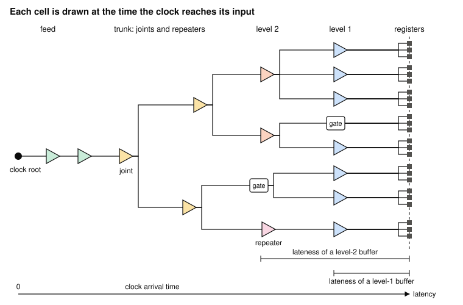
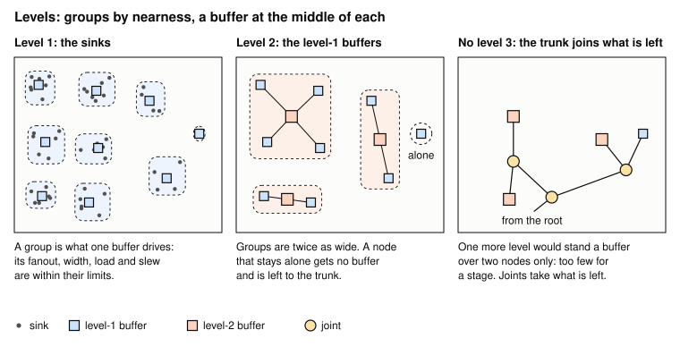
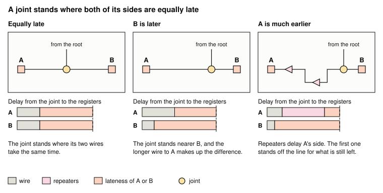

# Delay-Balanced Clock Trees

`clock_tree_synthesis -delay_balanced` builds each clock tree from the sinks toward the root and balances it on delay computed with the timer's delay calculator. This page describes how a tree is built. The [CTS README](../README.md#delay-balanced-trees) lists the options and the constraints the mode reads.

## Terms

| Term | Meaning |
| ----- | ----- |
| Sink | A load of the clock net: a register or macro clock pin, or the input of a cell the clock passes through, such as a clock gate. |
| Node | A sink, or a buffer the builder has made. |
| Lateness | The modeled delay from a node's input to the registers below it, as the mean over those registers. A register is 0 late. A clock gate is as late as its own delay plus the delay of everything between it and its registers. |
| Level | Buffers that are equally late. Level 1 stands over sinks, level 2 over level-1 buffers, and so on. |
| Trunk wire | 0.9 of the longest wire the strongest buffer drives into another of its kind within the slew limit. Group widths and wire lengths are bounded in trunk wires. |
| Stage | The delay of the strongest buffer driving two of its kind. Two sides count as equally late when they differ by less than 2% of a stage. |

## A tree by arrival time

The figure shows a finished tree with each cell drawn at the time the clock reaches its input. All registers stand on one line at the right. The distance from a node to that line is its lateness.



The builder works from right to left. At every step it makes the nodes under one cell equally late, with three means:

- the cell a node takes from `-buf_list` and `-root_buf`,
- the length of the wire to a node, set by where the cell above it stands,
- repeaters on the wire to a node.

Levels rely mostly on the first, the trunk on the second and the third, and the feed adds delay for all registers at once.

## Delay model

A stage is a cell and the net it drives. The net is a Steiner tree over its pins, reduced to a pi model at the driver and an Elmore delay to each load, with the via resistance of each pin: the shape `estimate_parasitics -placement` gives the timer. The cell is timed on that net with the timer's `ArcDelayCalc` from its Liberty tables.

Delays are those of the current scene. Slew is held within the limit on both edges in the scene where the buffers are slowest. A node's lateness is computed at a nominal input slew and corrected for the slew its driver gives it.

## Nets behind clock gates first

Every net of the clock network that has sinks gets a tree builder, as in the default flow. A net behind a clock gate is built before the net the gate is a sink of. The gate then enters that net as a sink with its timing arc, the load on its output, the lateness behind it, and the number of registers behind it.

A net is left as placed, without a tree, when its driving cell holds all its loads in one group within the fanout, diameter, load, and slew limits below. Clock gates are not cloned, moved, or resized.

## Levels



The builder keeps a pool of nodes that are about equally late. Registers start in the pool. Sinks with a lateness of their own wait, and join the pool at the level whose nodes are as late as they are, within a quarter of a level's delay. Each level takes these steps:

1. **Group.** The pool is cut by position, along the longer side of its bounding box, into parts of about 85% of the load the strongest buffer drives. A part is cut again until one buffer at its middle drives it: its Manhattan extent is within the group diameter, its load within the buffer's largest, and its slew within the limit. At level 1 a group also holds at most `-sink_clustering_size` sinks. The diameter is `-sink_clustering_max_diameter` at level 1 and doubles at each level, up to 1.25 trunk wires.
2. **Place.** The buffer of a group stands at the mean position of its nodes, on the nearest row. Where that point is on a macro or a placement blockage, it stands at the nearest row position beside it.
3. **Even out the group.** Each node that is a buffer takes, of the cells that drive its own net within the limits, the one that brings it nearest the group's median lateness. A group whose nodes still differ by more than 0.2 of a level's delay is split by lateness, and each part gets a buffer.
4. **Balance the level.** One lateness is chosen for the whole level: the one that leaves the least register-weighted difference over all buffers, given the cells each may take. Each buffer takes the cell that brings it nearest.
5. **Delay single nodes.** A buffer over one node is there to delay it. It takes the cell, and stands at the distance from its node, that makes it as late as the level. Where no cell does that, the node gets no buffer and is left to the trunk.

The number of levels is not set in advance. Above level 1, a group of one node is dissolved and the node is left to the trunk. A level is kept only when it has at most one buffer for every 2.5 nodes. When it has more, the groups are retried at twice the diameter. When the diameter is already 1.25 trunk wires, no further level is built. The levels also end when one node is left, or, on a net behind a clock gate, when the gate drives the pool itself.

## Trunk

The trunk joins the nodes the levels leave: the buffers of the last level, the nodes left out of a level, and sinks later than every level. It joins two nodes at a time under a joint, which is a buffer of the strongest cell, until one node is left.



**Order.** For each pair of nodes the lateness of their joint is estimated from the later of the two, the wire between them, and the difference of their lateness. The pair with the least estimate is joined next. A node much earlier than the others is joined first, because the others only get later as they are joined.

**Place.** A joint stands on a path between its two nodes: one bend, or the shortest way around the corners of macros and blockages. Its position on the path is found by bisection on the delay model, which times the joint with both wires, the repeaters, and the slew at each node. No wire is longer than a trunk wire. Repeaters are added one at a time, to the earlier side or, where a slew is over the limit, to the side with the longer wires, until one more brings the sides no nearer. What is still left is made up by moving the first repeater of the earlier side off the path, and by weaker cells for the two nodes.

**Two at a time.** A joint of two nodes has one free quantity, its position on the path, and one condition, that both sides be equally late. A joint of three would have to balance two differences with the same means. The cost is a stage per joint: where a stage is slow next to the wire it saves, the tree is later than an H-tree.

## Feed

Buffers lead from the net's driver to the last joint, one per trunk wire of the path, and one beside the driver where the driver does not hold the slew limit on the first wire. On a net behind a clock gate, the gate drives the remaining nodes directly where it can, and through repeaters to the last joint where it cannot.

With `set_clock_latency` on the clock, the feed brings the registers to that arrival. Delaying buffers stand beside the driver, and the wire between them is set by bisection. What they leave is made up by a longer way to the tree, and then by weaker cells for some of them. A tree that is already later than the target gets no delaying buffers.

In a flat design, where a cell drives the net, buffers also lead from the clock's port to that cell and from the cell to output ports of the clock net. The first buffer after the port stands no further than the port's slew allows.

## Two tries

A tree is first grown with the group diameter doubling level by level. Where that leaves groups narrower than 1.25 trunk wires above level 1, it is grown again with groups that wide from level 2. The tree whose registers get the clock earlier is kept, counting only what is over the latency target. Where the two are within 0.3 of a stage, the one whose registers are nearer one another is kept.

## Where each buffer stands

| Buffer | Instance name | Location |
| ----- | ----- | ----- |
| Over a group | `clkbuf_leaf`, `clkbuf_N` | The mean position of the group's nodes. |
| Over one node | `clkbuf_leaf`, `clkbuf_N` | On the way from the node to the middle of the core, at the distance that gives the level's lateness, half a trunk wire at most. |
| Joint | `clkbuf_joint` | On the path between its two nodes, where both sides are equally late. |
| Repeater | `clkbuf_rep` | Evenly along its side of the path. The first may stand off the path. |
| Feed | `clkbuf_feed` | Along the path from the driver to the last joint. Delaying buffers stand beside the driver. |
| Port and source | `clkbuf_port`, `clkbuf_source` | Along the path from the driver to the output ports, and from the clock's port to the driver. |

Every location is on a row's sites inside the core, clear of macros, placement blockages, and the fixed cells at the ends of rows, such as end caps beside a macro. Overlaps with other cells are left to detailed placement, as in the default flow.

## Reading a run

`set_debug_level CTS "delay balance" 1` reports each tree as it is built:

```text
tree clk_o level 1: 602 nodes under 80 buffers, 0 left to the trunk, lateness 29.11 ps
tree clk_o level 2: 261 nodes under 27 buffers, 0 left to the trunk, lateness 69.17 ps
tree clk_o level 3: 29 nodes under 5 buffers, 0 left to the trunk, lateness 107.66 ps
tree clk_o level 4: 10 nodes under 4 buffers, 0 left to the trunk, lateness 130.64 ps
tree clk_o trunk: 4 nodes from 85.33 to 132.02 ps late under 3 joints with 4 repeaters, off balance by 0.01 ps at most and 0.00 ps on average
```

Level 2 has more nodes than level 1 has buffers: clock gates that drive their registers directly are as late as a level-1 buffer and join the pool there. The four buffers of level 4 form no further level and go to the trunk. Debug level 2 adds each joint, with its repeaters and the difference it leaves.

## Source

| File | Content |
| ----- | ----- |
| `src/ClockDelayModel.{h,cpp}` | The delay model: Steiner wire reduction, cell and wire timing through `ArcDelayCalc`, slew limits, and the trunk wire. |
| `src/DelayBalancedTreeBuilder.{h,cpp}` | One tree: `grow` and `makeLevel` for the levels, `cluster` and `groupsOf` for the groups, `even`, `balance`, and `padSingles` for the cells, `joinAll` and `join` for the trunk, `feed` and `reach` for the way from the driver, `pathBetween` and `legal` for locations. The rules' constants are at the top of the `.cpp` file. |
| `src/TritonCTSDelayBalanced.cpp` | The order of the nets, the model of each clock gate, the latency target, and the connection of the driver to the tree. |
