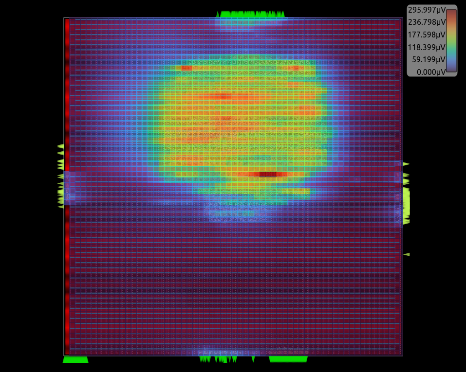
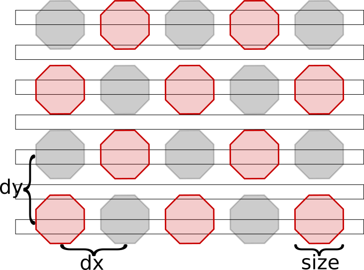
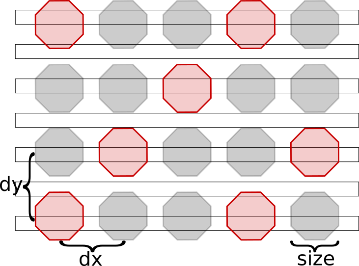
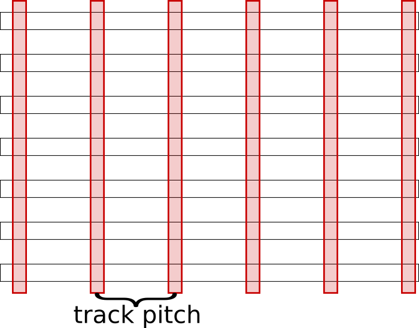

# IR Drop Analysis

The IR Drop Analysis module in OpenROAD (`psm`) is based on PDNSim,
an open-source static IR analyzer.

Features:

- Report worst IR drop.
- Report worst current density over all nodes and wire segments in the
  power distribution network, given a placed and PDN-synthesized design.
- Check for floating PDN stripes on the power and ground nets.
- Spice netlist writer for power distribution network wire segments.



## Commands

```{note}
- Parameters in square brackets `[-param param]` are optional.
- Parameters without square brackets `-param2 param2` are required.
```

### Analyze Power Grid

Analyze the selected power or ground net. The loaded design determines whether
PSM analyzes a single-chip PDN or the connected PDNs of a 3D assembly.
Both use the same current calculation, matrix construction, and numerical
solver. For an assembly, PSM prepares each chiplet's PDN and loads, joins the
PDNs through the bond resistors, and solves the connected network together.

For a 3D assembly, load the chiplets and bond resistors first, then set the
external supply with `set_pdnsim_net_voltage`. OpenSTA supplies the cell
loads from the Liberty power models and the design's clock and switching
activity. Saved PSM instance-power settings replace the corresponding STA
estimates. A value for the selected corner takes precedence over a default value.

The selected corner supplies the cell power, nominal supply voltage, layer
resistance, and source settings. Cell current is calculated as `I = P / V`;
setting a 3D source voltage does not change the nominal voltage used in this
calculation.

All sources on the analyzed net must have the same voltage for the selected
corner, matching 2D.

3D analysis requires a flat assembly with a supported OpenSTA timing network.
VDD and VSS are solved separately. Before solving, PSM checks connectivity
across the assembly and shorts inside each chiplet. Missing sources and invalid
resistances are rejected. Each 3D call builds a fresh solution. The current
3D output includes the node-voltage range, an IR summary, and per-instance
voltage files. `-enable_em` also prints maximum and average resistor currents
for chiplet wiring and inter-chip bonds. IR statistics use routing nodes, as in
2D. Percentage drop is relative to the source voltage for power nets; for ground
nets, it is the largest percentage rise relative to each chiplet's nominal
supply voltage.

The following 3D extensions are planned and are not included yet:

- The 2D `design_powergrid__...` IR and EM metrics.
- EM CSV export through `-em_outfile`.
- GUI IR-drop heatmaps.
- Source generation through `-vsrc` and `-source_type FULL|BUMPS|STRAPS`.
- Solution reuse through `-allow_reuse`.
- SPICE export of the connected chiplet network through `write_pg_spice`.
- Chiplet-aware instance lookup in `set_pdnsim_inst_power`.

Checks for shorts between different chiplets are also not supported.

```tcl
analyze_power_grid
    -net net_name
    [-corner corner]
    [-error_file error_file]
    [-voltage_file voltage_file]
    [-enable_em]
    [-em_outfile em_file]
    [-vsrc voltage_source_file]
    [-source_type FULL|BUMPS|STRAPS]
    [-allow_reuse]
```

#### Options

| Switch Name | Description |
| ----- | ----- |
| `-net` | Power or ground net name. For a 3D assembly, use the assembly net name. |
| `-corner` | Corner to use for analysis. |
| `-error_file` | File to write power grid errors to. For 3D, errors are grouped by chiplet, with coordinates in local microns. |
| `-vsrc` | File to set the location of the power C4 bumps/IO pins. [Vsrc_aes.loc file](test/Vsrc_aes_vdd.loc) for an example with a description specified [here](doc/Vsrc_description.md). |
| `-enable_em` | Print maximum and average power-grid segment currents. For 3D, includes chiplet wiring and inter-chip bonds. This reports currents, not a check against manufacturing EM limits. |
| `-em_outfile` | Write the per-segment current values into a file. Requires `-enable_em`. Supported only for 2D designs. |
| `-voltage_file` | Write per-instance voltage into the file. For 3D, instance names include the chiplet, such as `chipA/ff`; coordinates are local to each chiplet. |
| `-source_type` | Indicate the type of voltage source grid to [model](#source-grid-options). FULL uses all the nodes on the top layer as voltage sources, BUMPS will model a bump grid array, and STRAPS will model power straps on the layer above the top layer. |
| `-allow_reuse` | Allow the analysis to reuse a previous solution, if one exists. |

### Check Power Grid

Check connectivity of the selected power or ground net. The loaded design
determines whether PSM checks a single-chip PDN or a 3D assembly.

For a 3D assembly, PSM joins the chiplets' power grids at the bump contacts using
the bond resistors already stored in OpenDB. RCX extraction with technology
and assembly rules can create those resistors. The selected assembly net must
include at least two chiplet PDNs and an inter-chip resistor.

The assembly check runs the existing 2D checks for opens, shorts, and boundary
terminals inside each chiplet, then checks connectivity between chiplets.
Each chiplet's supply grid must be connected internally.

```tcl
check_power_grid
    -net net_name
    [-floorplanning]
    [-error_file error_file]
    [-dont_require_terminals]
```

#### Options

| Switch Name | Description |
| ----- | ----- |
| `-net` | Power or ground net name. For a 3D assembly, use the assembly net name. |
| `-floorplanning` | Ignore non-fixed instances in the power grid, this is useful during floorplanning analysis when instances may not be properly placed. For 3D assemblies, bond bump instances must be fixed. |
| `-error_file` | File to write power grid errors to. For 3D, errors are grouped by chiplet, with coordinates in local microns. |
| `-dont_require_terminals` | Skip requiring placed boundary pins. For 3D, this applies to each chiplet; disconnected cells, wires, and bumps are still checked. |

### Write Spice Power Grid

This command writes the `spice` file for power grid.

```tcl
write_pg_spice
    -net net_name
    [-vsrc vsrc_file]
    [-corner corner]
    [-source_type FULL|BUMPS|STRAPS]
    spice_file
```

#### Options

| Switch Name | Description |
| ----- | ----- |
| `-net` | Name of the net to analyze. Must be a power or ground net name. |
| `-vsrc` | File to set the location of the power C4 bumps/IO pins. See [Vsrc_aes.loc file](test/Vsrc_aes_vdd.loc) for an example and its [description](doc/Vsrc_description.md). |
| `-corner` | Corner to use for analysis. |
| `-source_type` | Indicate the type of voltage source grid to [model](#source-grid-options). FULL uses all the nodes on the top layer as voltage sources, BUMPS will model a bump grid array, and STRAPS will model power straps on the layer above the top layer. |
| `spice_file` | File to write spice netlist to. |

### Set PDNSim Net voltage

Set the voltage for a power or ground net. The loaded design determines whether
PSM sets a single-chip net voltage or a chiplet's voltage in a 3D assembly.
For a 2D design, provide `-net` and `-voltage` as before.

For a 3D assembly, also provide `-chiplet`. Use `-port` with `-voltage` to hold
that chiplet's port at a fixed source voltage. The source port must have a
single modeled pin shape. Setting the same source and corner again replaces
that voltage.

Use `-nominal_voltage` on the assembly power net to set the voltage used in
`I = P / V` for that chiplet. The assembly's bump mapping identifies the local
power net, so its name does not have to match the assembly net name. A call
with only `-nominal_voltage` does not create or change an external source.
A chiplet receiving power from another chiplet can therefore have its own
nominal voltage without becoming a source itself. Source and nominal voltages
can also be set in the same call. All voltages are in **volts**, independently
of display units.

```tcl
set_pdnsim_net_voltage
    -net net_name
    [-voltage volt]
    [-corner corner]
    [-chiplet chipA]
    [-port port]
    [-nominal_voltage voltage]
```

#### Options

| Switch Name | Description |
| ----- | ----- |
| `-net` | Power or ground net name. For a 3D assembly, use the assembly net name; `-nominal_voltage` requires a power net such as VDD. |
| `-voltage` | Required for 2D: sets the net voltage. For 3D: sets the fixed source voltage and requires `-port`. |
| `-corner` | Corner to use these settings. Defaults to the current corner. For 3D sources, set a source for each corner that will be analyzed. |
| `-chiplet` | Required for 3D: placed chiplet name from the `.3dbx` whose source or nominal voltage is being set. |
| `-port` | 3D chiplet boundary port receiving the external supply. Requires `-voltage`. |
| `-nominal_voltage` | Positive voltage used to convert the chiplet's cell power into current for both power and ground analysis. Does not change the Liberty power model. Available only for 3D assemblies. |

### Set PDNSim Instance power

This command sets PDNSim instance power.
This should only be used when needing to override the computed power.

```tcl
set_pdnsim_inst_power
    -inst inst_name
    -power power
    [-corner corner]
```

#### Options

| Switch Name | Description |
| ----- | ----- |
| `-inst` | Name of the instance to set the power dor. |
| `-power` | Sets the power on a specific instance. |
| `-corner` | Corner to use this power. If not specified, this power applies to all corners. |

### Set PDNSim Power Source Settings

Set PDNSim power source setting.

```tcl
set_pdnsim_source_settings
    [-bump_dx pitch]
    [-bump_dy pitch]
    [-bump_size size]
    [-bump_interval interval]
    [-strap_track_pitch pitch]
    [-external_resistance resistance]
```

#### Options

| Switch Name | Description |
| ----- | ----- |
| `-bump_dx`,`-bump_dy` | Set the bump pitch to decide the voltage source location. The default bump pitch is 140um. |
| `-bump_size` | Set the bump size. The default bump size is 70um. |
| `-bump_interval` | Set the bump population interval, this is used to depopulate the bump grid to emulate signals and other power connections. The default bump pitch is 3. |
| `-strap_track_pitch` | Sets the track pitch to use for modeling voltage sources as straps. The default is 10x. |
| `-external_resistance` | Set to model the resistance of the package or power network outside the chip/block. The default value is 0.0. |

### Insert Decap Cells
The `insert_decap` command inserts decap cells in the areas with the highest
IR Drop. The number of decap cells inserted will be limited to the target
capacitance defined in the `-target_cap` option. `list_of_decap_with_cap`
is a list of even size of decap master cells and their capacitances,
e.g., `<cell1> <decap_of_cell1> <cell2> <decap_of_cell2> ...`. To insert decap
cells in the IR Drop of a specific net (power or ground) use `-net <net_name>`,
if not defined the default power net will be used.
To use this command, you must first execute the `analyze_power_grid` command
with the net to have the IR Drop information.

```tcl
insert_decap -target_cap target_cap [-net net_name] -cells list_of_decap_with_cap
```

#### Options
| Switch Name | Description |
| ----- | ----- |
| `-target_cap` | Target capacitance to insert os decap cells. |
| `-net` | Power or ground net name. The decap cells will be inserted near the IR Drops of the net. |
| `-cells` | List of even size of decap master cells and their capacitances. |

## Source grid options

The source grid models how power is going be delivered to the power grid.
The image below illustrate how they can be modeled, the red elements are the source models, the black horizontal boxes represent the top metal layer of the power grid, and the gray boxes indicate these are not used in the modeling.

| Bumps with 2x interval | Bumps with 3x interval | Straps | Full |
| - | - | - | - |
|  |  |  |  |

### Selectively disconnecting sources

If you need to be able to disconnect some of the terminals in the design, such as in the case of "what-if" analysis or different chip packaging options.
This can be done by assigning `PSM_DISCONNECT` to a terminal or shape in a terminal will cause PDNSim to leave that object disconnected from the analysis.

<!-- checker: skip -->
```tcl
# Assumes bpin is the block pin to be disconnected
odb::dbBoolProperty_create $bpin PSM_DISCONNECT 1

# Assumes box the box shape in the bpin to be disconnected
odb::dbBoolProperty_create $box PSM_DISCONNECT 1
```

## Useful Developer Commands

If you are a developer, you might find these useful. More details can be found in the [source file](./src/pdnsim.cpp) or the [swig file](./src/pdnsim.i).

| Command Name | Description |
| ----- | ----- |
| `find_net` | Get a reference to net name. |

## Example scripts

Example scripts demonstrating how to run PDNSim on a sample design on `aes` as follows:

```
./test/aes_test_vdd.tcl
./test/aes_test_vss.tcl
```

## Regression tests

There are a set of regression tests in `./test`. For more information, refer to this [section](../../README.md#regression-tests).

Simply run the following script:

```shell
./test/regression
```

## Limitations

## References

1. PDNSIM [documentation](doc/PDNSim-documentation.pdf)
1. Chhabria, V.A. and Sapatnekar, S.S. (no date) The-openroad-project/pdnsim: Power Grid Analysis, GitHub. Available at: https://github.com/The-OpenROAD-Project/PDNSim (Accessed: 24 July 2023). [(link)](https://github.com/The-OpenROAD-Project/PDNSim)

## License

BSD 3-Clause License. See [LICENSE](../../LICENSE) file.
