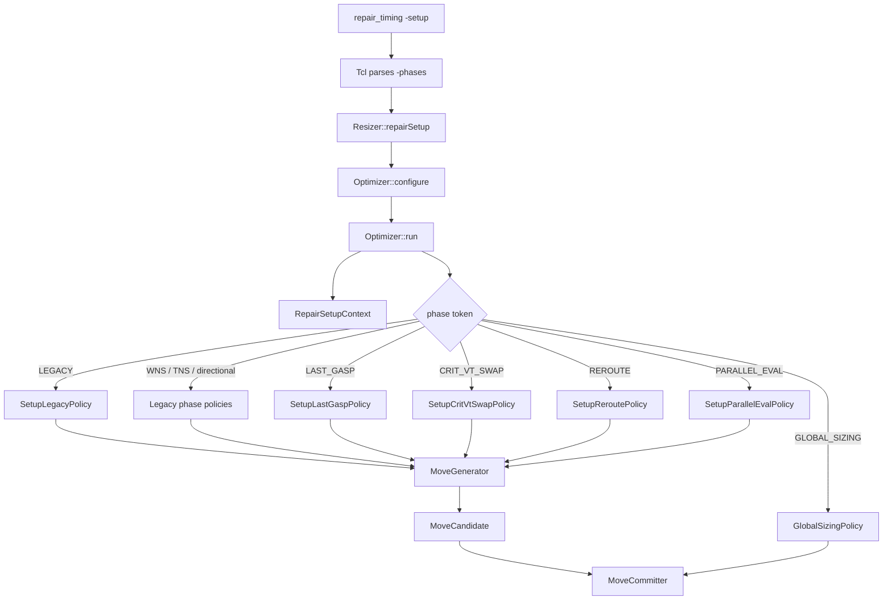
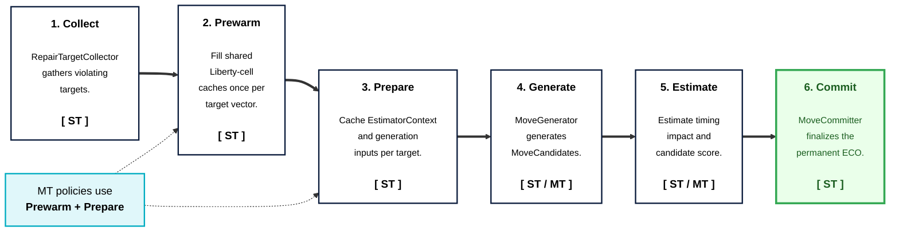
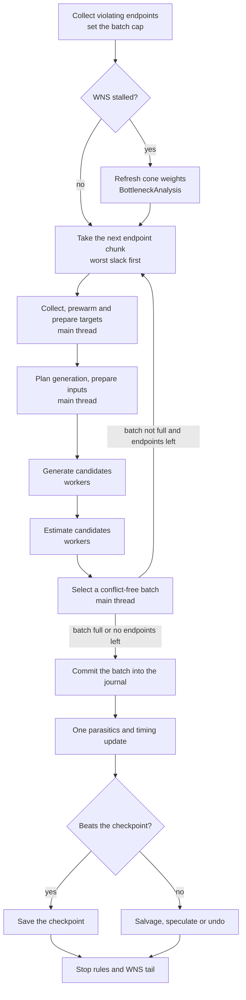

# Resizer Setup Repair Architecture

## Table Of Contents

1. [Summary](#summary)
2. [Top-Level Flow](#top-level-flow)
3. [Phase UI](#phase-ui)
4. [Core Data Model](#core-data-model)
5. [Policy Model](#policy-model)
6. [Prewarm Stage](#prewarm-stage)
7. [Prepare Stage](#prepare-stage)
8. [Delay Estimator And Reporter](#delay-estimator-and-reporter)
9. [Generator And Candidate Model](#generator-and-candidate-model)
10. [Threading Model](#threading-model)
11. [PARALLEL_EVAL Policy](#parallel_eval-policy)
12. [Profiler And Analysis](#profiler-and-analysis)
13. [Configuration](#configuration)
14. [Source Map](#source-map)
15. [Future Work](#future-work)

## Summary

`repair_timing -setup` runs a policy-driven optimizer.

| Area | Design |
|---|---|
| Phase pipeline | `repair_timing -phases` lists the phases. Each phase runs one `OptimizationPolicy`. |
| Moves | Each move type is a `MoveGenerator` that builds `MoveCandidate` objects. A candidate estimates itself and applies its ECO. |
| Commit | `MoveCommitter` owns the ECO journal, the move counters and the `MoveTracker` reports. |
| Multi-threading | `utl::ThreadPool` runs candidate generation and estimation. The main thread owns every STA update and OpenDB change. |
| Prewarm stage | The main thread fills lazy Liberty caches before worker threads read them. |
| Prepare stage | The main thread captures per-target STA data (`EstimatorContext`, generation inputs) so that workers do not query STA. The RebufferMt planner is the one exception (see Threading Model). |
| Delay estimator | Estimates the delay change of a move over a short path window from Liberty tables, without an STA update. |
| Mt moves | Thread-safe forms of seven moves: `VtSwapMt`, `SizeUpMt`, `RebufferMt`, `SplitLoadMt`, `SizeDownFanoutMt`, `SwapPinsMt` and `UnbufferMt`. |
| PARALLEL_EVAL | Experimental policy. It estimates many targets in parallel, commits a conflict-free batch and runs one STA update per batch. |
| Configuration | The policy and move tunables are fields of `OptimizationPolicyConfig`. The calibration constants of the estimators and the buffer-tree planner stay file-local. There are no environment variables. |
| Profiler | `-profile_mode 1..3` writes CSV traces of a run and, at mode 3, a report for every move. |
| Estimator reporter | `report_delay_estimator_accuracy*` commands compare an estimate with the measured STA result. |
| Scope | Only `repair_setup` uses this architecture. `repair_design`, `repair_hold` and `recover_power` can follow later. |
| Compatibility | The default pipeline keeps the legacy repair behavior. The QoR goal is ORFS design parity. |

**Overall repair_setup flow**

```text
[Optimizer::run()]
  start the profiler (-profile_mode, -profile_dir)
  resizer_.runRepairSetupPreamble()
  phases = parseTokens(-phases or "LEGACY LAST_GASP")
  append CRIT_VT_SWAP if a legacy phase is listed and CRIT_VT_SWAP is not
  for each phase:
    policy = makePolicyForPhase(phase)
    if (!policy->start()) return false
    while (!policy->converged()):
      policy->iterate()
    policy->finish()
  reportRunResult()


[OptimizationPolicy::iterate()]

LEGACY / SetupLegacyPolicy:
  select the next target -> generate -> estimate -> commit first accepted move   <- [ST]

PARALLEL_EVAL / SetupParallelEvalPolicy (EXPERIMENTAL):
  collect violating endpoints, set the batch cap    <- [ST]
  for each endpoint chunk, worst slack first:
    collect, prewarm and prepare targets            <- [ST]
    plan generation, prepare generation inputs      <- [ST]
    generate candidates, one task per target        <- [MT]
    estimate candidates, one task per target        <- [MT]
    select a score-ordered conflict-free batch      <- [ST]
  commit the batch into the open journal            <- [ST]
  update parasitics and timing once                 <- [ST]
  save, salvage, speculate or undo the batch        <- [ST]
```

**Key components**

```text
Optimizer
  Runs one repair_setup call; owns MoveCommitter and the profiler
  Maps each phase token to one OptimizationPolicy
  Prints the final report after the last phase

OptimizationPolicy (interface)
  SetupLegacyPolicy      : Legacy repair loop (the default main policy)
  SetupWnsPolicy         : Legacy WNS path / cone repair
  SetupTnsPolicy         : Legacy TNS repair
  SetupDirectionalPolicy : Legacy endpoint-fanin / startpoint-fanout repair
  SetupLastGaspPolicy    : Legacy last-gasp repair
  SetupCritVtSwapPolicy  : Legacy critical VT-swap repair
  SetupReroutePolicy     : Resistance-aware global reroute of slow nets
  GlobalSizingPolicy     : Lagrangian-relaxation sizing and VT assignment
  SetupParallelEvalPolicy: Parallel target evaluation, one STA per batch

MoveGenerator / MoveCandidate
  Own the move-local legality check and the ECO plan
  MoveGenerator::isApplicable() : Cheap check that the move fits the target
  MoveGenerator::prepareInputs(): Main-thread live reads for generate()
  MoveGenerator::generate()     : Build the candidates of one target
  MoveCandidate::estimate()     : Predict legality and score; no design change
  MoveCandidate::apply()        : Make the ECO change

MoveCommitter
  Owns journal checkpoints, commit/rollback and move accounting
  Reports policy and candidate events to MoveTracker
```

## Top-Level Flow



`Optimizer` is the top-level driver for one `repair_setup` call. `GlobalSizingPolicy` is not target driven, so it skips the generator and candidate pipeline.

```cpp
OptimizerRunConfig config;
config.sequence = sequence;
config.phases = phases != nullptr ? phases : "";
config.effort = effort;
config.profile_mode = profile_mode;
...
rsz::Optimizer optimizer(this);
optimizer.configure(config);
return optimizer.run();
```

| Step | Owner | Purpose |
|---|---|---|
| Configure | `Resizer::repairSetup()` | Freeze the Tcl/API options into `OptimizerRunConfig`. |
| Parse phases | `Optimizer::run()` | Tokenize `config.phases`, or use the default `LEGACY LAST_GASP`. Append `CRIT_VT_SWAP` when a legacy phase is listed. |
| Create policy | `Optimizer::makePolicyForPhase()` | Map one phase token to one concrete `OptimizationPolicy`. |
| Run policy | `OptimizationPolicy` | Select targets, prewarm and prepare data, generate candidates, estimate, commit and decide convergence. |
| Final report | `OptimizationPolicy` | Print the final progress row, the move tracker reports and the repair summary after the last phase. |

The optimizer does not implement move logic. Repair behavior belongs to the policies and the move implementations.

## Phase UI

`repair_timing -phases` is the public UI for selecting the setup-repair phase pipeline. The older spellings `-policy` and `-policies` are accepted aliases with identical semantics, but only `-phases` is listed in command help.

Only one of `-phases`, `-policy`, and `-policies` may be supplied in a single command. Tokens are whitespace-separated and matched exactly as shown below. If none is supplied, the default pipeline is `LEGACY LAST_GASP`. A pipeline that lists a legacy phase (`LEGACY`, `WNS*`, `TNS`, the directional phases or `LAST_GASP`) also gets one `CRIT_VT_SWAP` phase at the end, unless it already lists `CRIT_VT_SWAP`.

```tcl
# Default setup repair pipeline: LEGACY LAST_GASP CRIT_VT_SWAP.
repair_timing -setup

# Run selected legacy-compatible phases.
repair_timing -setup -phases "WNS TNS LAST_GASP"

# The experimental PARALLEL_EVAL policy is a phase token too.
repair_timing -setup -phases "PARALLEL_EVAL" -effort medium

# Alias spelling; prefer -phases for new scripts.
repair_timing -setup -policy "LEGACY"
```

Phase tokens:

| Token | Policy | Purpose |
|---|---|---|
| `LEGACY` | `SetupLegacyPolicy` | Main legacy-compatible setup repair loop. |
| `WNS`, `WNS_PATH` | `SetupWnsPolicy` | Legacy WNS path phase. |
| `WNS_CONE` | `SetupWnsPolicy` | Legacy WNS cone phase. |
| `TNS` | `SetupTnsPolicy` | Legacy TNS phase. |
| `ENDPOINT_FANIN` | `SetupDirectionalPolicy` | Legacy endpoint-fanin phase. |
| `STARTPOINT_FANOUT` | `SetupDirectionalPolicy` | Legacy startpoint-fanout phase. |
| `LAST_GASP` | `SetupLastGaspPolicy` | Legacy last-gasp repair phase. |
| `CRIT_VT_SWAP` | `SetupCritVtSwapPolicy` | Legacy critical VT-swap post phase. |
| `REROUTE` | `SetupReroutePolicy` | Resistance-aware incremental global reroute of the slowest wires on violating paths. |
| `GLOBAL_SIZING` | `GlobalSizingPolicy` | Lagrangian-relaxation global sizing and VT assignment. |
| `PARALLEL_EVAL` | `SetupParallelEvalPolicy` | Experimental: parallel target evaluation and batch commit. |

`PARALLEL_EVAL` is an experimental policy documented in the PARALLEL_EVAL section of the README, and the error message lists it as experimental.

Related options:

| Option | Meaning |
|---|---|
| `-sequence` | Move order inside the legacy-style policies, and the move set of `PARALLEL_EVAL`. |
| `-effort low\|medium\|high` | Stop-rule preset of `PARALLEL_EVAL`; the other policies ignore it. The default is `high`. See [Effort Levels](#effort-levels). |
| `-profile_mode 0..3` | Setup repair profiler level; see [Profiler And Analysis](#profiler-and-analysis). |
| `-profile_dir dir` | Profiler output directory; the default is `repair_setup_profile`. |

## Core Data Model

The optimizer shares a small set of typed data structures between policies, generators, candidates, and the committer. `MoveType` names the move family. `Target` holds the selected timing object plus the per-target data that the prepare stage captured for worker threads. `Estimate` is what a candidate returns from `estimate()`.

### Move Type

`MoveType` (`rsz/Resizer.hh`) is the single enum for setup-repair move kinds.

```cpp
enum class MoveType : uint8_t
{
  kBuffer,
  kClone,
  kSizeUp,
  kSizeUpMatch,
  kSizeDownFanout,
  kSwapPins,
  kVtSwap,
  kUnbuffer,
  kSplitLoad,
  kReroute,
  kBufferToInverters,
  kCount
};
```

### Target

`Target` is the policy-selected object that generators operate on. A target may expose multiple **views**. For example, a path-driver target also exposes an instance view when its driver pin belongs to a standard-cell instance.

```cpp
struct Target
{
  // Identity and views.
  TargetViewMask views{kPathDriverView};
  sta::Pin* driver_pin{nullptr};
  const sta::Pin* endpoint_pin{nullptr};
  const sta::Pin* violated_endpoint_pin{nullptr};

  // Path-driver view.  Path pointers are valid until the next STA update.
  const sta::Path* endpoint_path{nullptr};
  int path_index{-1};
  const sta::Path* driver_path{nullptr};
  int fanout{0};
  sta::Slack slack{0.0};
  const sta::Scene* scene{nullptr};
  const sta::MinMax* min_max{nullptr};

  // Prepared data for MT generation and estimation.
  std::optional<EstimatorContext> estimator_context;
  std::shared_ptr<const SequentialTimingEstimator> sequential_timing_estimator;

  // Generation inputs (MoveGenerator::prepareInputs()).
  std::optional<std::vector<Resizer::InputCapBudget>> input_cap_budgets;
  BufferedNetPtr rebuffer_net;
  RebufferLoadTimingMap rebuffer_load_timing;
  std::shared_ptr<const SplitLoadMtInput> split_load_input;
  std::shared_ptr<const SwapPinsMtInput> swap_pins_input;
  std::optional<float> unbuffer_gain;
  std::vector<std::shared_ptr<const SizeDownFanoutMtLoad>> size_down_fanout_loads;

  bool canBePathDriver() const;
  bool canBeInstance() const;
};
```

| View bit | Meaning | Typical use |
|---|---|---|
| `kPathDriverView` | Driver stage on a timing path | Buffer, clone, size, swap pins, unbuffer, split load |
| `kInstanceView` | Target instance output pin | Instance-level VT-swap style flows |

`Target` also resolves its pins, instance, vertex and paths lazily from STA (`resolvedPin()`, `inst()`, `driverPath()`, `inputPath()` and others), so a target stays usable after earlier commits invalidated its path pointers. It can be extended to represent a net or a sub-graph. New prepared fields can be added for new move types.

### Estimate

```cpp
struct Estimate
{
  bool legal{false};
  float score{0.0f};
  std::optional<float> raw_gain{};
  std::string_view reason{};   // why the candidate is not legal
  std::optional<float> sequential_penalty{};
  std::optional<float> sequential_side_loss{};
  std::optional<float> side_loss{};
};
```

`score` ranks the candidates. `raw_gain` is the unscaled arrival improvement in seconds. `side_loss` is the slack the move costs side paths, and the `sequential_*` fields are the opposite-side setup/hold cost of a flip-flop swap.

## Policy Model

`OptimizationPolicy` is the abstract base for setup-repair strategies.

```cpp
class OptimizationPolicy
{
 public:
  virtual const char* name() const = 0;
  virtual bool start();
  virtual void iterate() = 0;
  virtual void finish();
  bool converged() const;
  virtual bool showStartpointMetrics() const;

 protected:
  virtual void buildMoveGenerators(const std::vector<MoveType>& move_types,
                                   const GeneratorContext& context);
  PrepareCacheMask accumulatePrepareRequirements() const;
  virtual void prewarmTargets(const std::vector<Target>& targets) const;
  virtual void prepareTargets(std::vector<Target>& targets) const;
  Target prepareTarget(const Target& target) const;
  std::unique_ptr<utl::ThreadPool> makeWorkerThreadPool() const;

  OptimizationPolicyConfig policy_config_;
  ProgressReporter progress_;
};
```

Each policy receives the same `RepairSetupContext`, `MoveCommitter`, and run configuration. `OptimizationPolicy::start()` returns `false` only when the full optimizer run should stop before any iteration. Otherwise, `iterate()` is called until `converged()` becomes true. `finish()` then ends the phase before the next one starts: it undoes the phase-local setup of `start()`. PARALLEL_EVAL uses it to stop recording critical-path load pins and release its worker threads. `finish()` is an explicit call instead of the destructor, because it logs and writes profiler records that should not run while an error unwinds the command. The policy ends with its phase, and after the last phase `Optimizer::reportRunResult()` prints the final report of the command: the closing progress row, the tracker reports and the move summary. `ProgressReporter` prints the progress table that every policy shares.

```cpp
RepairSetupContext setup_context(resizer_);
bool show_startpoint_metrics = false;
for (int i = 0; i < phase_count; ++i) {
  setup_context.phase_index = i;
  std::unique_ptr<OptimizationPolicy> policy
      = makePolicyForPhase(phase_names[i], setup_context);
  if (!policy->start()) {
    return false;
  }
  while (!policy->converged()) {
    policy->iterate();
  }
  policy->finish();
  show_startpoint_metrics = policy->showStartpointMetrics();
}
return reportRunResult(setup_context, show_startpoint_metrics);
```

The legacy policies share `SetupLegacyBase`, which owns the legacy move sequence, target construction, endpoint journal handling and progress reporting. See [Phase UI](#phase-ui) for the token-to-policy map.

> NOTE: `PARALLEL_EVAL` is not production quality yet.

### Legacy vs. ParallelEval

| Policy | Target ordering | Move ordering | MT usage |
|---|---|---|---|
| `SetupLegacyPolicy` | Endpoint by endpoint, path-driver targets | Legacy sequence; the first accepted move commits | None |
| `SetupParallelEvalPolicy` | Violating endpoints in worst-slack chunks per batch | The best Mt candidate of each target, then a cross-target ranking | Generation and estimation run on workers, one task per target; the batch commits serially before one timing update |

### Stage Pipeline



## Prewarm Stage

The prewarm stage fills shared lazy caches before per-target generation starts. It is separate from `prepareTargets()` because these caches are owned by `Resizer` / `dbNetwork`, not by individual `Target` objects.

| Prewarm data | Used by | Main reason |
|---|---|---|
| Swappable-cell cache | SizeUp and SizeUpMt candidate selection | Avoid repeated `getSwappableCells()` and VT metadata work. |
| VT-equivalent-cell cache | VtSwap and VtSwapMt candidate selection | Avoid repeated `getVTEquivCells()` and VT metadata work. |

Some APIs look read-only from the caller but fill internal caches on first use. Prewarming keeps that mutation on the main thread.

Future direction:

> Prewarm stage can be reduced or removed if STA provides easier warmup (complete all lazy updates) API to ensure thread safety before parallel operations.

## Prepare Stage

The prepare stage computes expensive target-local data once, on the main thread, before MT-safe generation and estimation. It has two parts.

The target-level data the generators read is prepared for every target of the stage:

```cpp
PrepareCacheMask mask = accumulatePrepareRequirements();
for (Target& target : targets) {
  prepareTarget(target, mask);
}
```

Generators declare this data with mask constants:

```cpp
PrepareCacheMask prepareRequirements() const override
{
  return kEstimatorContextCache | kSequentialEstimatorCache;
}
```

Current prepare masks:

| Mask | Cached data | Main reason |
|---|---|---|
| `kNoPrepareCache` | none | Default for generators that do not read prepared target fields. |
| `kEstimatorContextCache` | `Target::estimator_context` | Snapshot of the timing arcs, input slews, load caps and current delays of the path window. `DelayEstimator` requires it. |
| `kSequentialEstimatorCache` | `Target::sequential_timing_estimator` | Flip-flop input-side checks that a cell swap of the target may disturb. |

The generation inputs are the live STA reads of one Mt generator, so that its `generate()` runs on a worker thread. The policy calls `MoveGenerator::prepareInputs()` on the main thread right before `generate()`, after its skip rules, so only the targets a generator runs on pay for them:

```cpp
generator->prepareInputs(target);  // main thread
generator->generate(target);       // a worker thread in PARALLEL_EVAL
```

| Generator | `prepareInputs()` fills | Content |
|---|---|---|
| `VtSwapMt`, `SizeUpMt` | `Target::input_cap_budgets` | Fanin max-cap headroom; the second cell-swap generator of a target reuses it. `SizeUpMt` also adds the target arc's replacement cells to its run cache. |
| `RebufferMt` | `Target::rebuffer_net`, `Target::rebuffer_load_timing` | The driver net as a buffered-net tree and its load timing. |
| `SplitLoadMt` | `Target::split_load_input` | The split the generator chose from live STA; its candidates share it. |
| `SwapPinsMt` | `Target::swap_pins_input` | The measured arc delays through the equivalent inputs; `generate()` picks the fastest. |
| `UnbufferMt` | `Target::unbuffer_gain` | The delay that removing the target's buffer is estimated to save. |
| `SizeDownFanoutMt` | `Target::size_down_fanout_loads` | Each fanout load and its one-step-down cell, measured; `generate()` keeps the steps that fit. |

`SetupParallelEvalPolicy::planGeneration()` calls it per generator, and the rebuffering accuracy report calls it for `RebufferMt`. The Mt moves do not share code with the serial moves: each `prepareInputs()` has its own copy of the selection logic, so a change to a serial move cannot change an Mt move.

### Why prepare stage is needed

- Some STA state-read APIs include non-trivial computation.
- Calling those APIs repeatedly from candidate generation/estimation adds computational overhead.
- The prepare stage caches such data for fast worker access in parallel.
- Prepare stage can also be used to avoid the use of non-thread-safe APIs by threads if such non-safe APIs exist.

For example, retrieving load capacitance via STA API is not cheap as follows:

```text
OptimizationPolicy::prepareTargets()
  or OptimizationPolicy::prepareTarget(const Target&)
  -> OptimizationPolicy::prepareTarget(target, mask)
     -> OptimizationPolicy::prepareEstimatorContext()
        -> DelayEstimator::buildContext()
           -> GraphDelayCalc::loadCap(driver_pin, scene, min_max)   // STA API
              -> for RiseFall::range():
                 -> GraphDelayCalc::loadCap(driver_pin, rf, scene, min_max)
                    -> GraphDelayCalc::loadCap(..., pin_cap, wire_cap)
                       -> graph_->pinDrvrVertex(driver_pin)
                       -> GraphDelayCalc::multiDrvrNet(driver_vertex)
                       -> GraphDelayCalc::parasiticLoad(...)
                          -> scene->parasitics(min_max)
                          -> GraphDelayCalc::netCaps(...)
                             -> Sdc::connectedCap(...)
                                -> Sdc::netCaps(...)
                                   -> network_->visitConnectedPins(driver_pin, FindNetCaps)
                                      -> FindNetCaps::operator()(pin)
                                         -> Sdc::pinCaps(...)
                                            -> Sdc::portCapacitance(...)
                                               -> Sdc::pvt(inst, min_max)
                                               -> LibertyPort::scenePort(scene, min_max)
                                               -> Sdc::operatingConditions(min_max)
                                               -> LibertyPort::capacitance(...)
                          -> ArcDelayCalc::findParasitic(driver_pin, rf, scene, min_max)
                          -> Parasitics::capacitance(parasitic)
              -> ArcDelayCalc::finishDrvrPin()
```

This is a graph/parasitic/SDC traversal, not a trivial field read. Caching it in `Target::estimator_context` avoids repeating the same work for every MT candidate.

Future direction:

> If STA state read APIs become cheaper and clearly thread-safe, this prepare stage will be reduced or removed.

## Delay Estimator And Reporter

`DelayEstimator` is a stateless helper split into main-thread context construction and worker-safe candidate scoring.

| API | Threading | Purpose |
|---|---|---|
| `buildContext()` | Main thread | Read STA/OpenDB state and build the `EstimatorContext` of one target. |
| `estimate(context, candidate_cell)` | Worker-safe | Estimate a cell replacement over the path window from Liberty tables. |
| `estimateLoadChange()` | Worker-safe | Estimate the target stage under a new load, for moves that change the fanout. |
| `estimateBufferTreeWithSidePaths()` | Worker-safe | Estimate a whole buffer tree, including the slack its side loads lose. |

`EstimatorContext` holds the target timing stage plus an optional path window:

```text
delay_levels = 0  -> target stage only
delay_levels = N  -> up to N valid fanin stages + target + up to N valid fanout stages
```

The prepared state includes the selected Liberty arc, input slew, load cap, current model delay/slew, STA graph delay/slew, output-slew merge arcs, and STA slew-bias samples. An optional side model charges the slack that fanin siblings and buffer-tree side loads lose (`fanin_side_loss`), and `dual_rf_eval` scores the opposite output transition as well.

Current estimator approximations:

| Item | Handling |
|---|---|
| Target cell | Re-evaluated with the candidate Liberty cell. |
| Fanin neighbor load | Adjusted by the target input capacitance delta. |
| Fanout input slew | Propagated from the estimated upstream output slew. |
| Interconnect slew | Preserves the current receiver/driver slew ratio; it does not recalculate full RC waveform degradation. |
| Arc matching | Exact match is preferred; the target candidate can use relaxed port/RF matching when needed. |
| STA slew bias | Samples three load points on the main thread and interpolates in workers. |

`SequentialTimingEstimator` adds an opposite-side setup/hold estimate for flip-flop replacements: the input driver load and slew changes and the Liberty check-table deltas. Wire RC, reconvergence and clock paths keep their prepared values, and latches are excluded.

`DelayEstimatorReporter` is a diagnostic layer, not part of the MT contract. It compares an estimator prediction against a measured STA result:

```tcl
report_delay_estimator_accuracy \
  -inst u1 -lib_cell BUF_X4 -estimator stage_window -delay_levels 1

report_delay_estimator_accuracy_for_rebuffering \
  -inst u1 -delay_levels 1
```

The estimator names are `legacy` and `stage_window`. `-delay_levels` accepts `0`, `1`, or `2` for `stage_window`. The reporter runs on the main thread, finds the worst setup target for the instance, builds the requested estimator profile, applies the candidate inside an ECO journal, updates timing, records the STA "golden" result, and restores the original design. The rebuffering report plans and scores the trees as RebufferMt does in PARALLEL_EVAL, through `RebufferMtGenerator::prepareInputs()` and `generate()` and `RebufferMtCandidate::estimate()`, and reports the tree RebufferMt scores best.

## Generator And Candidate Model

Each move type is split into two classes.

| Role | Class | Responsibility |
|---|---|---|
| Generator | `MoveGenerator` derived class | Decide applicability and create candidate objects for one target. |
| Candidate | `MoveCandidate` derived class | Estimate one concrete ECO proposal and apply it if selected. |

`MoveGenerator::isApplicable()` first checks whether the `Target` provides the views required by that generator, then derived classes add move-specific cheap checks.

```cpp
virtual bool isApplicable(const Target& target) const
{
  const TargetViewMask views = requiredViews();
  return ((views & kPathDriverView) != 0 && target.canBePathDriver())
         || ((views & kInstanceView) != 0 && target.canBeInstance());
}

protected:
  virtual TargetViewMask requiredViews() const { return kPathDriverView; }
```

Most generators use the default `kPathDriverView`. `VtSwapGenerator` overrides `requiredViews()` to accept both `kPathDriverView` and `kInstanceView`.

Minimal flow:

```cpp
if (generator->isApplicable(target)) {
  generator->prepareInputs(target);
  CandidateVector candidates = generator->generate(target);
  for (const std::unique_ptr<MoveCandidate>& candidate : candidates) {
    Estimate estimate = candidate->estimate();
  }
}
```

Each step has one job, so the work that needs the main thread stays out of the steps that run on workers:

| Step | Thread | Reads | Job |
|---|---|---|---|
| `isApplicable()` | main | `Target` fields, committed moves, dont-touch | Rule the move out before any live STA read. |
| `prepareInputs()` | main | Live STA, placement, Liberty, the delay calculator | Store what `generate()` needs on the `Target`. |
| `generate()` | worker in `PARALLEL_EVAL` | Prepared `Target` fields, the netlist and Liberty | Build the candidates; no live STA, no logging. |
| `estimate()` | worker in `PARALLEL_EVAL` | Prepared `Target` fields | Score one candidate. |
| `apply()` | main | - | Change the design inside the batch journal. |

`RebufferMtGenerator::generate()` is the one exception: its worker planner reads STA results that stay fixed while the workers generate. The Threading Model section gives the conditions.

Candidate lifecycle:

```text
generate()
  -> estimate()      // No OpenDB mutation; MT policies may run this in workers
  -> apply()         // OpenDB/STA mutation under MoveCommitter ECO journal
```

A candidate also reports what it touches (`impact()`) and which side pins it may slow down (`guardedSidePins()`), so that `PARALLEL_EVAL` can keep conflicting moves out of one batch and find the move that hurt a missed batch.

Current generator/candidate families:

| Move type | Serial generator | Mt generator | Mt generation inputs |
|---|---|---|---|
| Buffer | `BufferGenerator` | `RebufferMtGenerator` | Buffered-net tree and load timing |
| Clone | `CloneGenerator` | - | - |
| SizeUp | `SizeUpGenerator` | `SizeUpMtGenerator` | Fanin max-cap headroom |
| SizeUpMatch | `SizeUpMatchGenerator` | - | - |
| SizeDownFanout | `SizeDownFanoutGenerator` | `SizeDownFanoutMtGenerator` | One drive step down per fanout load |
| SwapPins | `SwapPinsGenerator` | `SwapPinsMtGenerator` | Equivalent input pins and their measured arc delays |
| VtSwap | `VtSwapGenerator` | `VtSwapMtGenerator` | Fanin max-cap headroom |
| Unbuffer | `UnbufferGenerator` | `UnbufferMtGenerator` | Eligible buffer and its estimated saving |
| SplitLoad | `SplitLoadGenerator` | `SplitLoadMtGenerator` | Less critical half of the loads and the buffer |
| Reroute | `RerouteGenerator` | - | - |
| BufferToInverters | `BufferToInvertersGenerator` | - | - |

Each generator `XGenerator` has a matching candidate `XCandidate`. The Mt generators read only prepared data in `generate()`, and their candidates score themselves from the prepared `EstimatorContext`, so both run on worker threads.

A generator that keeps state per worker thread sets it up in `startPhase()`, which learns the worker count, and releases it in `finishPhase()`. `PARALLEL_EVAL` calls both on the main thread from its `start()` and `finish()`; the default keeps no state.

## Threading Model

`utl::ThreadPool` is a common utility, not an rsz-local class.

```cpp
std::unique_ptr<utl::ThreadPool> OptimizationPolicy::makeWorkerThreadPool() const
{
  const int thread_count = static_cast<int>(resizer_.staState()->threadCount());
  const int worker_thread_count = std::max(0, thread_count - 1);
  return std::make_unique<utl::ThreadPool>(worker_thread_count);
}
```

`ThreadPool` exposes both value-returning and void batch APIs:

```cpp
thread_pool_->parallelMap(items, [](const Item& item) -> Result { ... });
thread_pool_->parallelFor(items, [](const Item& item) { ... });
```

When the pool has zero workers, `submit()` executes the task immediately on the caller thread. This keeps policy code uniform and the single-thread behavior deterministic, with no separate single-thread code path.

Threading rules:

| Rule | Reason |
|---|---|
| Keep the main thread for orchestration and commit | ECO journal, OpenDB mutation, and STA update are serialized. |
| Use worker threads only on prepared or prewarmed data | Workers do not query STA, except the RebufferMt planner (below); the prewarm and prepare stages run first on the main thread. |
| Support zero worker threads | `ThreadPool::submit()` runs tasks inline when no workers exist, so callers can still use `parallelMap()` / `parallelFor()` without a separate serial branch. |
| Support nested `parallelMap()` / `parallelFor()` | Worker threads waiting on child tasks help drain the same pool, so nested fork-join work does not self-deadlock. |
| Merge worker statistics after the join | Workers count into task-local records; the main thread folds them into the profiler and the move counters. |

Parallelization currently used by policy implementation:

```text
SetupParallelEvalPolicy:
  per endpoint chunk
    -> main thread: plan generation and prepare its inputs per target
    -> workers: generate() of every planned generator, one task per target
    -> workers: estimate() of every candidate, one task per target
    -> main thread: select and commit the batch, one timing update
```

`RebufferMt` plans a buffer tree with `Rebuffer`, which keeps mutable scratch state. `RebufferMtGenerator` therefore makes one `Rebuffer` planner per pool thread in `startPhase()` (`RebufferPlannerPool`), and each `generate()` call leases one for its duration. A worker planner counts its warnings by message ID instead of logging them, because their order and the per-ID print limits of `utl::Logger` would make the log depend on the thread schedule. `finishPhase()` logs the counts in one line (RSZ-2034); a single-thread run plans on the main thread and logs each warning.

The worker planner is the one exception to the rule that workers do not query STA. It reads the worst-slack paths of the loads, the input slews of the driver, clock arrivals and slew limits. The reads are safe because the main thread keeps the timing fixed while the workers generate, `startPhase()` creates the slew-limit checker on the main thread, and these queries never update the search. The planner writes only its own state and the slack marks on the net copy that `prepareInputs()` built for the target. Its debug prints (`set_debug_level RSZ rebuffer`) also come from the workers.

## PARALLEL_EVAL Policy

`SetupParallelEvalPolicy` replaces "one move, one STA update" with "one batch, one STA update". It estimates many targets in parallel, commits a conflict-free batch, measures the batch with one timing update and keeps it only if it helps.



The policy owns the journal, the STA queries, the generators and the batch outcome flow in `iterate()`. Its run state lives in small classes in `policy/ParallelEvalState.hh`:

| Class | Holds |
|---|---|
| `WorkMeter` | The work counters behind the stall window and the tail budget. |
| `StallMonitor` | Progress of saved checkpoints, the stall budget and the stall window. |
| `WnsTail` | Tail stages, speculation, widening and the tail stop decision. |
| `MissTabu` | Instances skipped after undone batches, for a while or for good. |

### Move Set

`-sequence` is the move set. `vt_swap`, `sizeup`, `buffer`, `split`, `size_down`, `unbuffer` and `swap` map to `VtSwapMt`, `SizeUpMt`, `RebufferMt`, `SplitLoadMt`, `SizeDownFanoutMt`, `UnbufferMt` and `SwapPinsMt`. `clone`, `sizeup_match`, `reroute` and `buffer_to_inverters` have no `PARALLEL_EVAL` form and are skipped with a warning.

An omitted sequence runs `unbuffer vt_swap sizeup buffer split`. `VtSwapMt` runs before `SizeUpMt` because it keeps the cell footprint, so it takes the slack it can before `SizeUpMt` spends area on the same path. The default goes through the same filter as an explicit sequence: `-skip_buffer_removal` drops `UnbufferMt`, `-skip_vt_swap` or a single-VT library drops `VtSwapMt`, and `-skip_buffering` drops `RebufferMt` and `SplitLoadMt`.

### Evaluation Funnel

A batch commits at most `batch_cap` moves, but evaluation cost grows with every endpoint evaluated. So the violating endpoints are evaluated worst slack first, in chunks of `eval_endpoint_factor` times the cap (at least `eval_min_endpoints`). After each chunk the batch is selected again, and the next chunk runs only while the batch is not full. The batch is therefore built from the most critical endpoints first.

The cap is the failing endpoint count, clamped to `min_batch_cap` and `max_batch_cap`.

### Target Ranking

Each target keeps its best candidate by score, and the score alone ranks the targets against each other. Once a saved batch left WNS where it was, the targets are weighted by their share of the violating cone instead:

```
priority = score * (1 + bottleneck_scale * severity_ratio^bottleneck_exponent)
```

The slack deficit of a vertex is `slack_margin - slack`. `BottleneckAnalysis` walks the fanin cone of the worst violating endpoints and sums the deficits of distinct downstream endpoints and upstream startpoints at each vertex. Their geometric mean is the bottleneck severity; `severity_ratio` divides it by the largest severity in the cone (or is zero outside the cone). This prioritizes shared violating paths while WNS is stalled, not only the single worst path.

`parallel_eval.priority` (`BatchPriorityConfig`) holds the ranking options:

| Field | Default | Effect |
|---|---|---|
| `bottleneck_scale` | `2` | Strength of the bottleneck priority factor. `0` ranks by score alone. |
| `bottleneck_exponent` | `2` | Emphasis on the most shared bottlenecks. |
| `bottleneck_max_wns_stall_batches` | `8` | The bonus applies to at most this many WNS-stalled saved batches in a row. `0` ranks by score alone. |
| `bottleneck_refresh_batches` | `4` | Batches one analysis serves. The start of the WNS tail refreshes it. |
| `bottleneck_max_endpoints` | `1024` | Violating endpoints one analysis weighs, worst slack first. |
| `bottleneck_max_startpoints` | `1024` | Distinct cone startpoints one analysis weighs. |

### Batch Selection

`BatchSelector` walks the ranked targets and admits a candidate unless it conflicts with one already in the batch:

- Structural conflicts are always checked: two moves may not write the same instance or net, reconnect the same pin, or write an instance that the other reconnects. A `RebufferMt` candidate reserves both its driver instance and the net it rewrites.
- A candidate whose timing depends on a move already in the batch is deferred: the instances or nets the earlier move changes feed the candidate's own path. The check is one way, so a candidate that changes what a member's estimate read is still admitted. Every estimate reads the pre-batch timing either way, and the batch outcome below catches a batch that misses.

### Batch Outcome

The batch commits inside a journal that stays open after the latest checkpoint. After the timing update (under `-path_group`, WNS and TNS are the group's, and an endpoint's slack is its group slack, as in `LEGACY`):

- **Save.** WNS improved, or TNS improved while WNS stayed within `checkpoint_wns_tolerance_period_pct` percent of the reference clock period below the best checkpoint WNS. With `-max_utilization`, the design area must also stay below that limit; the first batch over it prints warning RSZ-2033.
- **Salvage.** A missed batch finds its culprits: moves whose guarded side pins fell below the pre-batch design WNS, or whose own endpoint got worse. A cell swap is a culprit only if its own stage delays grew. Culprit swaps go back to their old cells in place; a batch with a buffer culprit rolls back and re-commits the rest.
- **Speculate.** In the WNS tail, a missed batch may stay for up to `wns_tail_speculate` batches. A later save keeps all of them; otherwise they all roll back.
- **Undo.** Otherwise the batch rolls back. Its instances are skipped for `miss_tabu_batches` batches, and an instance in `max_undos_per_instance` or more undone batches is excluded for the rest of the run.

The batches end after `max_checkpoint_misses` missed batches in a row, or on one of the stop rules below. If no batch has kept a move by then, the policy first retries once with `retry_batch_cap` moves per batch. The retry starts with a fresh stall budget, takes the instances of the undone batches off the tabu list, and drops the selector's score floor and worst-path reserve. Otherwise the WNS tail starts, or the run stops when the tail is off or already ran.

### Stop Rules

The batches stop after `stall_max_batches` batches whose checkpoints moved neither WNS by `progress_wns_period_pct` percent of the reference clock period nor TNS by `progress_tns_pct` percent of the initial TNS, or sooner once those batches spent `stall_batches` full batches of moves. A windowed rule also stops them when the last `stall_window` saved batches moved WNS by less than `stall_wns_period_pct` percent of the reference clock period and the failing endpoint count by less than `stall_failing_endpoint_pct` percent per batch, and TNS did not progress.

The reference clock period is the shortest period of a clock with source pins in any mode, fixed for the run; a virtual clock counts only when no clock has pins, without clocks the shortest `set_max_delay` is the scale, and without either the initial WNS is. A share of the WNS itself would vanish as WNS approaches zero, so tiny gains near closure would never stall the batches.

The stall window and the tail budget count **work**, not wall time. Work is a weighted count of timing updates, pending nets, estimates, buffer-tree plans and evaluated endpoints (`work_*` weights), in seconds of a reference machine. So a run makes the same decisions on every machine and under any load.

### WNS Tail Stage

When the batches stall, the WNS tail works on the worst `wns_tail_endpoints` endpoints with small batches (one move, doubling after every saved batch up to `wns_tail_batch`). The tail:

- may also try candidates that the estimator rejected but whose own gain is positive, because the batch STA judges them;
- adds `SwapPinsMt`, `UnbufferMt` (single-move batches only) and `SizeDownFanoutMt` when the run has no `-sequence`;
- rejects a batch that costs more TNS than `wns_tail_tns_ratio` times its WNS gain;
- widens by `wns_tail_grow` up to `wns_tail_max_endpoints` endpoints when it stalls, and ends after `wns_tail_stall` batches that do not raise the best WNS by `wns_tail_min_gain_period_pct` percent of the reference clock period.

The tail may spend `wns_tail_work_pct` percent of the work of the batch stage, and at least `wns_tail_min_work`.

### Effort Levels

`repair_timing -effort` trades runtime for the last WNS gains:

| Effort | Behavior |
|---|---|
| `high` (default) | Runs the WNS tail stage after the batch stage ends. |
| `medium` | Runs the WNS tail stage with looser exit conditions, so the tail ends early. |
| `low` | Skips the WNS tail stage. The run ends with the batch stage. |

### Rebuffer Controls

`RebufferMt` is the only buffering move of `PARALLEL_EVAL`, and planning trees is the most expensive generation step. At most `rebuffer_max_targets` targets per batch plan buffer trees, worst slack first.

## Profiler And Analysis

`RepairSetupProfiler` records run-local diagnostics. Modes 1 and 2 never change repair decisions. Mode 3 can: it refreshes timing around every applied move, and the LEGACY loop picks its next target from the refreshed timing. Each `repair_timing -setup` call writes one `run_N` directory under `-profile_dir`:

| Mode | Files | Content |
|---|---|---|
| `0` | none | Off (default). |
| `1` | `metadata.csv`, `stats.csv`, `timing.csv` | Run settings, scope timers and counters, the WNS/TNS trajectory. |
| `2` | adds `events.csv` | Pass and batch events: commits, checkpoints, undo and stop reasons. |
| `3` | adds `analysis/` | Per-move observations and reports. |

Mode 3 measures every applied move with `RepairSetupMoveSampler`, a main-thread timing observer, and writes:

| File | Content |
|---|---|
| `analysis_moves.csv` | One row per applied move with the estimated and measured gain. |
| `analysis_pins.csv`, `analysis_arcs.csv`, `analysis_connections.csv` | Local pin, arc and net-capacitance changes of each move. |
| `analysis_paths.csv`, `selected_windows.csv` | Path snapshots before and after a move, and the prepared path windows. |
| `analysis_outcomes.csv` | Whether each move was kept or undone later in the run. |
| `bad_moves.md`, `moves/move_NNNNNN.md` | A summary of the flagged moves and one readable report per flagged move. |

Mode 3 runs much slower than mode 0. Take runtime numbers only from runs with the profiler off.

Workers never write files or touch the profiler. They count into task-local records (`DeferredCounts`) that the main thread merges after the join.

## Configuration

`OptimizationPolicyConfig` (`src/OptimizationPolicyConfig.hh`) holds every tuning constant, grouped by consumer:

| Group | Read by |
|---|---|
| `delay_estimation_levels`, `sta_slew_bias`, the side models (`fanin_side_loss*`, `side_floor_margin`, `dual_rf_eval`) | `DelayEstimator` and the Mt candidates |
| `dual_rf_drive_guard`, `size_up_mt_*` | `VtSwapMt` and `SizeUpMt` |
| `rebuffer_mt_*`, `allow_rebuffer_mt_single_buffer` | `RebufferMt` |
| `parallel_eval` (`ParallelEvalPolicyConfig`) | `SetupParallelEvalPolicy` only |
| `split_load_mt_*`, `size_down_fanout_mt_*` | The topology moves |

The default member initializers are the base values. `OptimizationPolicyConfig::forParallelEval(effort)` returns the `PARALLEL_EVAL` variant: it turns on the side models (`fanin_side_loss`, `dual_rf_eval`), bounds the size-up drive jump (`size_up_mt_max_drive_ratio`), sets the RebufferMt gates and applies the `-effort` preset. The knobs are not user options. A new experiment adds a field with a default that keeps the current behavior.

## Source Map

| Area | Files (`src/rsz/src/`) |
|---|---|
| Driver | `Optimizer.*`, `RepairSetupContext.hh`, `OptimizerTypes.*` |
| Configuration | `OptimizationPolicyConfig.*` |
| Policy base | `policy/OptimizationPolicy.*`, `policy/ProgressReporter.*` |
| Legacy policies | `policy/SetupLegacyBase.*`, `policy/SetupLegacyPolicy.*`, `policy/SetupWnsPolicy.*`, `policy/SetupTnsPolicy.*`, `policy/SetupDirectionalPolicy.*`, `policy/SetupLastGaspPolicy.*`, `policy/SetupCritVtSwapPolicy.*`, `policy/SetupReroutePolicy.*` |
| Global sizing | `policy/GlobalSizingPolicy.*`, `LRSubproblem.*` |
| PARALLEL_EVAL | `policy/SetupParallelEvalPolicy.*`, `policy/ParallelEvalState.*`, `policy/BatchSelector.*`, `policy/BottleneckAnalysis.*` |
| Moves | `move/MoveGenerator.*`, `move/MoveCandidate.*`, `move/<Move>Generator.*`, `move/<Move>Candidate.*` |
| Commit and tracking | `MoveCommitter.*`, `MoveTracker.*` |
| Target collection | `RepairTargetCollector.*` |
| Estimation | `DelayEstimator.*`, `DelayEstimatorBufferTree.cc`, `DelayEstimatorInternal.hh`, `SequentialTimingEstimator.*`, `Rebuffer.*`, `BufferedNet.*` |
| Estimator reports | `DelayEstimatorReporter.*` |
| Profiler | `RepairSetupProfiler.*`, `RepairSetupMoveSampler.*`, `RepairSetupMoveSnapshot.*`, `RepairSetupAnalysisReport.*`, `RepairSetupAnalysisTarget.*` |
| Thread pool | `src/utl/include/utl/ThreadPool.h`, `src/utl/src/ThreadPool.cpp` |

## Future Work

1. Enhance setup optimization QoR and runtime
    a. Ensure thread safety of STA read APIs to shrink the prewarm and prepare stages
2. Support DRC / hold / power optimization
